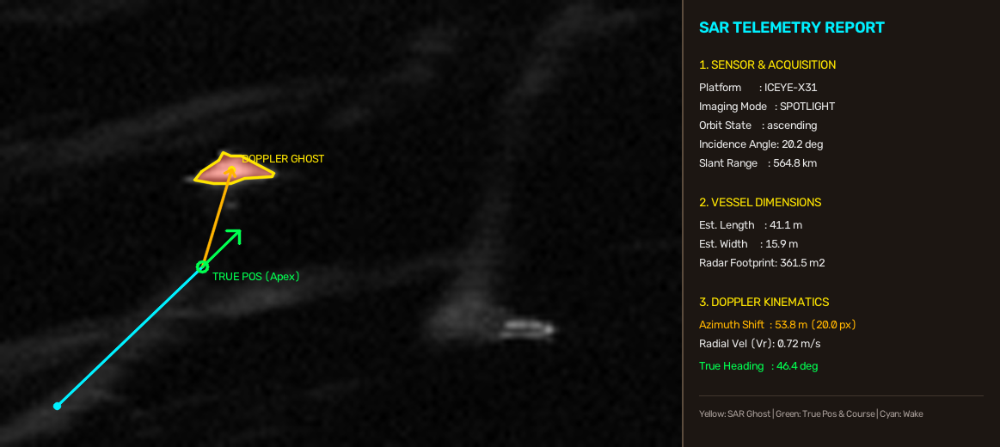
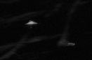
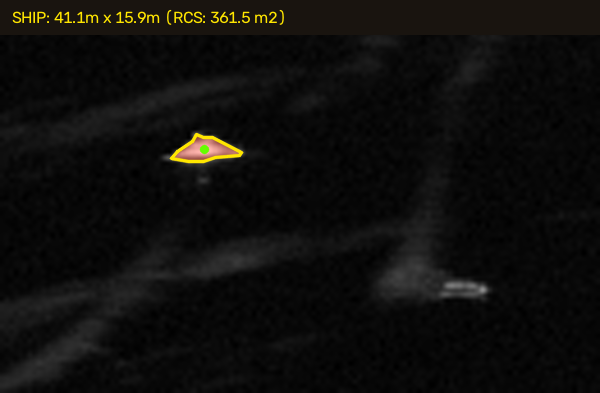
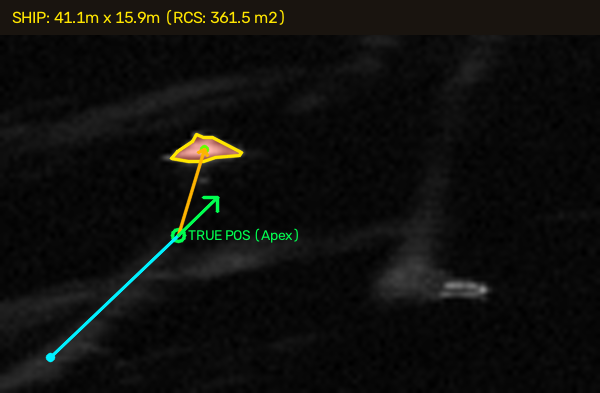

# SAR Dark Vessel Kinematics & Wake Analyzer

Python-pohjainen analyysityökalu "pimeiden alusten" paikantamiseen, mittaamiseen sekä kulkusuunnan ja nopeuden määrittämiseen yhdestä X-kaistan SAR-satelliittikuvasta.

---

## Projektin tarkoitus ja tausta

Idea projektin rakentamiseen lähti ICEYEn "Value of SAR" -luentosarjasta, joka käsittelee SAR teknologiaa ja käytännön sovelluksia. Luentosarjan inspiroimana tavoitteena oli toteuttaa käytännön analyysiputki, joka soveltaa SAR-kuvausteorian ilmiöitä suoraan aitoon satelliittidataan.

Merenkulun valvonnassa alukset voivat kytkeä automaattisen tunnistusjärjestelmänsä (AIS) pois päältä piilottaakseen sijaintinsa tai reittinsä. Optiset satelliitit ovat puolestaan riippuvaisia pilvettömästä säästä ja päivänvalosta. 

SAR näkee pilvien läpi ja toimii yöllä, mutta liikkuva kohde aiheuttaa tutkakuvaan fysikaalisen ilmiön: Doppler-atsimuuttisiirtymän. Koska SAR-satelliitti paikantaa kohteet niiden paluusignaalin Doppler-taajuuden perusteella, liikkuvan laivan tutkaheijastus siirtyy kuvassa sivuun sen todellisesta paikasta. Laivan veteen jättämä perävana sen sijaan pysyy paikallaan ja paljastaa, missä alus todellisuudessa on ja mihin suuntaan se kulkee.

Tämä projekti yhdistää konenäön, interaktiivisen perävanavektoroinnin ja SAR-tutkafysiikan määrittääkseen yhdestä pysäytyskuvasta:
1. Aluksen todellisen sijainnin.
2. Aluksen fyysiset mitat (pituus, leveys ja tutkajäljen pinta-ala).
3. Aluksen todellisen kulkusuunnan (kompassisuunta asteina).
4. Aluksen nopeuden (solmuina ja km/h).

---

## Aineisto (ICEYE Open SAR Data)

Projektissa käytetään ICEYE Open Data Catalog avointa X-kaistan SAR-tutkadataa, joka noudetaan AWS S3 -pilvestä STAC-rajapinnan kautta:
* **Satelliitti:** ICEYE-X31 (korkeus $H \approx 530\text{ km}$, ratanopeus $V_s \approx 7600\text{ m/s}$).
* **Kuvaustila:** `SLEDF` (Spotlight Extended Dwell / korkean resoluution kohdekuvaus).
* **STAC-metatiedot:** Ohjelma lukee STAC JSON -tiedostosta automaattisesti kuvaushetken katselukulman ($\theta$, *incidence angle*), pikselikoon sekä kiertoradan suunnan.

---

## Analyysiputken vaiheet (Moduulit 1–5)

Ohjelma on jaettu viiteen itsenäiseen moduuliin (`src/`), joita ohjataan `main.py`-pääohjelmasta.

### Vaihe 1: Kuvan ja metatietojen haku (`src/fetcher.py`)
Moduuli lataa STAC-metatiedot pilvestä, laskee kuvan efektiivisen pikselitarkkuuden ($\text{m/px}$) ja avaa koko satelliittikuvan interaktiiviseen ikkunaan. Käyttäjä rajaa hiirellä tutkittavan laivan ja sen perävanan (ROI), jotka tallennetaan paikalliseen välimuistiin (`data/`).

| Rajattu SAR-kuvaleike (`roi_patch.png`) |
| :---: |
|  |

---

### Vaihe 2: Aluksen segmentointi ja mittaus (`src/detector.py`)
Pieni kuvaleike skaalataan bikubisella interpoloinnilla alipikselitarkkuuteen, ja speckle-kohinaa vaimennetaan reunoja säästävällä bilateraalisuodatuksella. Algoritmi etsii ensin laivan kirkkaimman ytimen ja laajentaa sen jälkeen segmentoinnin koko vaaleaan runkoon meritaustan keskihajontaan perustuvalla CFAR-tyylisellä kynnystyksellä. Lopuksi laivan ympärille sovitetaan käännetty suorakulmio (`cv2.minAreaRect`), josta saadaan aluksen pituus, leveys ja painopiste $(x_s, y_s)$.

| Konenäöllä segmentoitu ja mitattu alus (`step2_segmented_ship.png`) |
| :---: |
|  |

---

### Vaihe 3: Perävanan määritys (`src/annotator.py`)
Koska merenkäynti tekee heikon perävanan täysin automaattisesta tunnistuksesta epävarmaa, käyttäjä merkitsee hiirellä kaksi pistettä:
1. **Perävanan kärki:** Piste, josta vana alkaa. Tämä on laivan todellinen sijainti kuvaushetkellä $(x_w, y_w)$.
2. **Perävanan häntä:** Piste, johon vana jatkuu $(x_t, y_t)$.

Ohjelma piirtää automaattisesti oranssin Doppler-siirtymävektorin todellisesta sijainnista tutkaheijastukseen sekä vihreän kulkusuuntanuolen.

| Perävana, todellinen paikka ja siirtymävektori (`step3_annotated_wake.png`) |
| :---: |
|  |

---

### Vaihe 4: Fysiikka- ja nopeuslaskenta (`src/physics.py`)
Fysiikkamoduuli ratkaisee aluksen kinematiikan yhdistämällä STAC-metatiedot ja mitatut vektorit:

1. **Viistoetäisyys satelliitista kohteeseen (Slant Range, $R$):**
   $$R = \frac{H}{\cos(\theta)}$$
   missä $H = 530\,\text{km}$ on satelliitin ratakorkeus ja $\theta$ on tutkan katselukulma.

2. **Atsimuuttisiirtymä ($\Delta x$):**
   Lasketaan etäisyys perävanan kärjen $(x_w, y_w)$ ja laivan tutkaheijastuksen keskipisteen $(x_s, y_s)$ välillä ja muunnetaan se metreiksi:
   $$\Delta x = \sqrt{(x_s - x_w)^2 + (y_s - y_w)^2} \cdot \text{GSD}_{\text{eff}}$$

3. **Säteittäinen nopeus ($v_r$):**
   Kohteen nopeuskomponentti kohti tutkaa tai siitä poispäin saadaan SAR-atsimuuttisiirtymän yhtälöstä:
   $$v_r = \frac{\Delta x \cdot V_s}{R}$$
   missä $V_s = 7600\,\text{m/s}$ on satelliitin ratanopeus.

4. **Todellinen nopeus merenpinnalla ($v_{\text{ship}}$) ja kulkusuunta:**
   Kulkusuuntavektori $\vec{u} = (x_w - x_t, \, y_w - y_t)$ määrittää aluksen kompassisuunnan sekä kulman $\phi$ suhteessa tutkan katselusuuntaan. Säteittäinen nopeus projisoidaan merenpinnan tasolle ja muunnetaan solmuiksi ($1\,\text{m/s} = 1.94384\,\text{kn}$):
   $$v_{\text{ship}} = \frac{v_r}{\sin(\theta) \cdot |\cos(\phi)|}$$

---

### Vaihe 5: Loppuraportin koonti (`src/visualizer.py`)
Viimeinen moduuli ottaa Vaiheen 3 vektoroidun kuvan, liittää sen alle telemetriapaneelin kaikista lasketuista suureista ja tallentaa valmiin tilannekuvan (`data/final_sar_analysis.png`).

---
